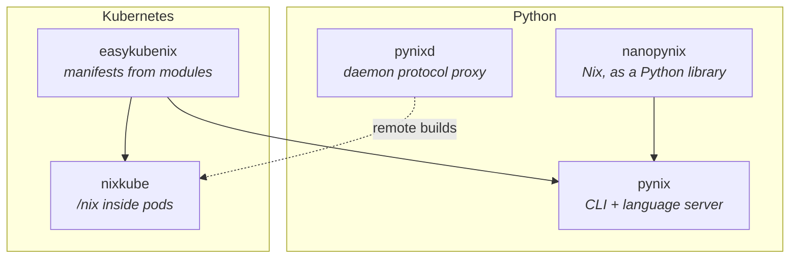

# Nixidae

**Python and Nix, in both directions.**

Nixidae is the home of a set of related projects: Python libraries that drive
Nix, Nix tooling written in Python, and infrastructure that hands Nix store
paths to systems that were never designed to receive them.

They are separate repositories with separate release cycles, but they share a
premise — that Nix is worth talking to from a real programming language, and
that Python is a good one for the job.

## Projects

| Project | What it is |
| --- | --- |
| [**nanopynix**](https://github.com/Lillecarl/nanopynix) | nanobind-based Python bindings for Nix. Nix runs in an isolated worker subprocess and is driven over gRPC, so several differently configured Nix instances can run in parallel from one process. Async API for stores, evaluation and builds. |
| [**pynix**](https://github.com/Lillecarl/nanopynix/tree/develop/pynix) | A Nix CLI built on nanopynix — `build`, `eval`, `develop`, `repl`, `store`, `path-info`, `flake`, option search — plus a Nix language server that understands the NixOS module system. |
| [**pynixd**](https://github.com/Lillecarl/pynixd) | The Nix daemon protocol, in Python. Sits between Nix clients and remote builders over SSH: deduplicates concurrent builds, caches path queries locally, and schedules work across multiple backends. |
| [**nixkube**](https://github.com/Lillecarl/nixkube) | Mounts `/nix` into Kubernetes pods through a CSI driver and an NRI plugin. Store paths, flake refs and Nix expressions become pod volumes with pod lifetime. |
| [**easykubenix**](https://github.com/Lillecarl/easykubenix) | Kubernetes manifests from the NixOS module system, without generating Nix types for the whole Kubernetes API. Validation runs against an ephemeral `etcd` and `kube-apiserver`. |

## How the pieces fit

`nanopynix` is the foundation: everything that needs to evaluate or build
without shelling out to the `nix` binary goes through it. `pynix` is what that
looks like as a tool you actually type. `pynixd` speaks the daemon wire
protocol instead of the C API, so it can slot in wherever a `nix-daemon` would.
`easykubenix` and `nixkube` are the Kubernetes end: one produces the manifests,
the other makes the store available to the pods they describe.

## Where to start

- **Curious what Nix-from-Python looks like?** Read the
  [nanopynix quickstart](https://lillecarl.github.io/nanopynix/).
- **Want a faster `nix repl` / better editor support?** Look at `pynix`.
- **Running Nix builds across machines?** Look at `pynixd`.
- **Running Nix in Kubernetes?** Look at `nixkube`.

## Status

Nixidae is new. The repositories above still live under
[@Lillecarl](https://github.com/Lillecarl) and are moving here; GitHub keeps the
old URLs working, so nothing you bookmark today will break.

Everything here is pre-1.0 and moving. Issues and pull requests are welcome on
the individual repositories — see [CONTRIBUTING.md](https://github.com/nixidae/.github/blob/main/CONTRIBUTING.md)
for how that works, and [SECURITY.md](https://github.com/nixidae/.github/blob/main/SECURITY.md)
if you have found something that should not be reported in public.
